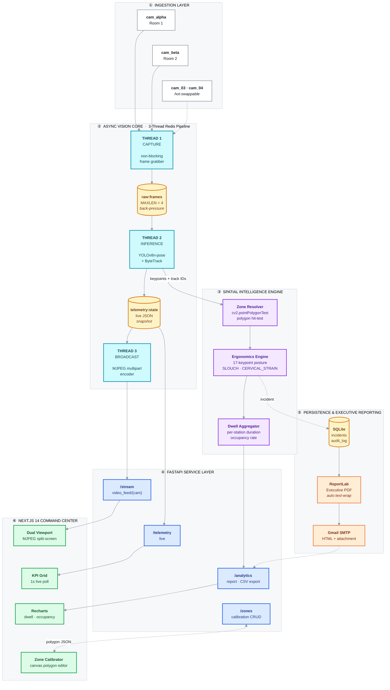
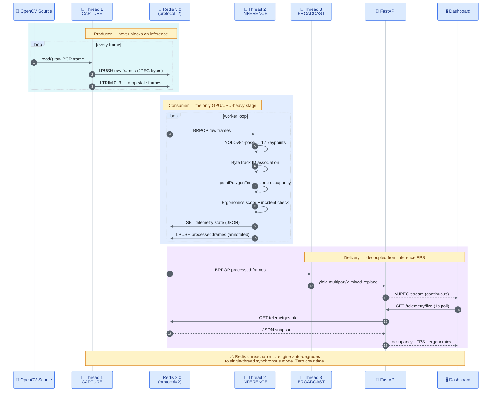

<div align="center">

# OmniPresence-AI

### Autonomous Workplace Spatial Intelligence & Vision Telemetry Platform

Real-time desk-occupancy analytics from CCTV. Pose-based ergonomics monitoring.
Executive audit reporting. Built as a production-grade multi-camera VMS.

<br/>


</div>

---

## 📐 System Architecture

OmniPresence-AI is built in **six decoupled layers**. The critical design decision is
layer ②: video capture, model inference, and stream delivery each run on their **own
thread**, communicating only through Redis queues. No layer ever blocks another.



---

## ⚡ The Async Vision Core

A naive CV service does `read → infer → encode → yield` in one loop. That couples
camera FPS to model latency: inference stalls the grab, frames pile up, and the
browser receives a stream that is seconds behind reality.

OmniPresence splits that loop into **three independent threads** joined by Redis:

| Thread | Responsibility | Blocks on | Why it is isolated |
|:---|:---|:---|:---|
| **① Capture** | `cv2.VideoCapture.read()`, JPEG encode, `LPUSH raw:frames` | I/O only | Keeps grabbing at native camera FPS even while the model is busy |
| **② Inference** | `BRPOP` → YOLOv8n-pose → ByteTrack → zone + ergonomics → `SET telemetry:state` | CPU / GPU | The only expensive stage; isolating it stops it from throttling capture |
| **③ Broadcast** | `BRPOP processed:frames` → `multipart/x-mixed-replace` | network | Slow or disconnecting clients can never back-pressure the model |

### Bounded queue — the anti-lag guarantee

```python
QUEUE_MAX_LEN = 4          # ~130ms of buffer at 30fps
pipe.lpush("raw:frames", payload)
pipe.ltrim("raw:frames", 0, QUEUE_MAX_LEN - 1)   # discard stale frames
```

If inference falls behind, old frames are **dropped, not buffered**. The viewer
always sees the present rather than an ever-growing backlog — the correct trade-off
for live surveillance, where a frame from 8 seconds ago has no value.

### Graceful degradation

Redis is an accelerator, not a hard dependency. If the connection fails at startup,
the engine logs the reason and falls back to a single-threaded synchronous loop.
The dashboard keeps working at reduced throughput; nothing crashes.

> **Compatibility note.** Redis 3.0.504 (the common Windows build) predates RESP3 and
> rejects the `HELLO` handshake that `redis-py` sends by default. The client is pinned
> with `protocol=2` so the same codebase runs on both legacy Windows Redis and modern
> Linux Redis.

---

## 🔄 Request Lifecycle

How a single photon of light becomes a number on the dashboard:



---

## 🧠 Spatial Intelligence Pipeline

Inside Thread 2, each frame passes through four stages:

| Stage | Technique | Output |
|:---|:---|:---|
| **Detection** | YOLOv8n-pose | Person boxes + 17 COCO keypoints |
| **Identity** | ByteTrack association | Stable `track_id` across frames |
| **Localization** | `cv2.pointPolygonTest` against calibrated polygons | `station_id ← track_id` binding |
| **Ergonomics** | Neck/torso/shoulder angles from keypoints | Score 0-100, `SEVERE_SLOUCH` / `CERVICAL_STRAIN` incidents |

Zones are not hard-coded. The **Zone Calibrator** in the dashboard lets an operator
draw occupancy polygons directly on a live frame; the geometry is persisted per
camera and reloaded by the engine, so deploying to a new room needs no code change.

---

## 🗂️ Project Structure

```
OmniPresence-AI/
│
├── src/
│   ├── services/
│   │   ├── telemetry_service.py      # ⚡ 3-thread Redis pipeline + fallback
│   │   ├── notification_service.py   # Gmail SMTP, HTML body + PDF attachment
│   │   └── report_service.py         # ReportLab executive PDF generator
│   ├── core/
│   │   ├── ergonomics.py             # 17-keypoint posture scoring
│   │   ├── tracker.py                # ByteTrack ID association
│   │   └── zones.py                  # pointPolygonTest occupancy resolver
│   ├── api/v1/
│   │   ├── stream.py                 # MJPEG multipart endpoints
│   │   ├── telemetry.py              # live state snapshot
│   │   ├── analytics.py              # CSV export + report download
│   │   └── notifications.py          # email dispatch
│   ├── db/
│   │   ├── database.py               # SQLite session + schema
│   │   └── seeder.py                 # demo incident generator
│   └── main.py                       # FastAPI app factory + lifespan
│
├── web-frontend/
│   └── src/
│       ├── app/
│       │   ├── page.tsx              # Command center dashboard
│       │   └── globals.css           # Tailwind v4 entry
│       ├── components/
│       │   ├── AnalyticsCharts.tsx   # Recharts dwell-time + occupancy
│       │   └── ZoneCalibrator.tsx    # Canvas polygon editor
│       └── types/
│           └── telemetry.ts          # Shared API contract types
│
├── data/
│   ├── videos/                       # per-camera source footage
│   ├── zones/                        # calibrated polygon JSON
│   └── omnipresence.db               # SQLite store
│
├── models/
│   └── yolov8n-pose.pt
│
└── requirements.txt
```

---

## 🛠️ Tech Stack

| Layer | Technology | Role |
|:---|:---|:---|
| **Vision** | YOLOv8n-pose · OpenCV · ByteTrack | Detection, keypoints, identity persistence |
| **Concurrency** | Redis · Python `threading` | Decoupled 3-stage pipeline, bounded queues |
| **Backend** | FastAPI · Uvicorn · Pydantic | Async HTTP, MJPEG streaming, typed contracts |
| **Persistence** | SQLite · SQLAlchemy | Incident store + immutable audit trail |
| **Reporting** | ReportLab · smtplib | Executive PDF, Gmail SMTP delivery |
| **Frontend** | Next.js 14 (App Router) · TypeScript | Server/client component dashboard |
| **UI** | Tailwind CSS v4 · Recharts · lucide-react | Command-center visual system |

---

## 🌐 API Reference

| Method | Endpoint | Purpose |
|:---|:---|:---|
| `GET` | `/api/v1/stream/video_feed/{camera_id}` | Annotated MJPEG live stream |
| `GET` | `/api/v1/telemetry/live` | Occupancy, FPS, per-station ergonomics |
| `POST` | `/api/v1/video/upload/{camera_id}` | Hot-swap source footage for a channel |
| `GET` | `/api/v1/analytics/latest-report/download` | CSV export of session analytics |
| `POST` | `/api/v1/notifications/send-report-email` | Email executive PDF to a recipient |
| `GET` `POST` | `/api/v1/zones/{camera_id}` | Read / persist occupancy polygons |

---

## 🚀 Quick Start

```bash
# 1 — Backend
git clone https://github.com/immanueltampubolon594/OmniPresence-AI.git
cd OmniPresence-AI
python -m venv venv && venv\Scripts\activate       # Windows
pip install -r requirements.txt

redis-server                                        # separate terminal
uvicorn src.main:app --reload --port 8000

# 2 — Frontend
cd web-frontend
npm install
npm run dev                                         # http://localhost:3000
```

On a healthy start the engine reports:

```
[REDIS] Koneksi berhasil — pipeline asinkron aktif.
[ENGINE] cam_alpha  → CAPTURE | INFERENCE | BROADCAST threads online
[ENGINE] cam_beta   → CAPTURE | INFERENCE | BROADCAST threads online
```

Without Redis it reports the fallback instead, and the dashboard still runs:

```
[REDIS] Tidak tersedia — beralih ke mode single-thread sinkron.
```